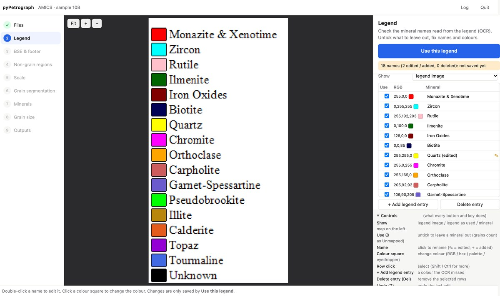
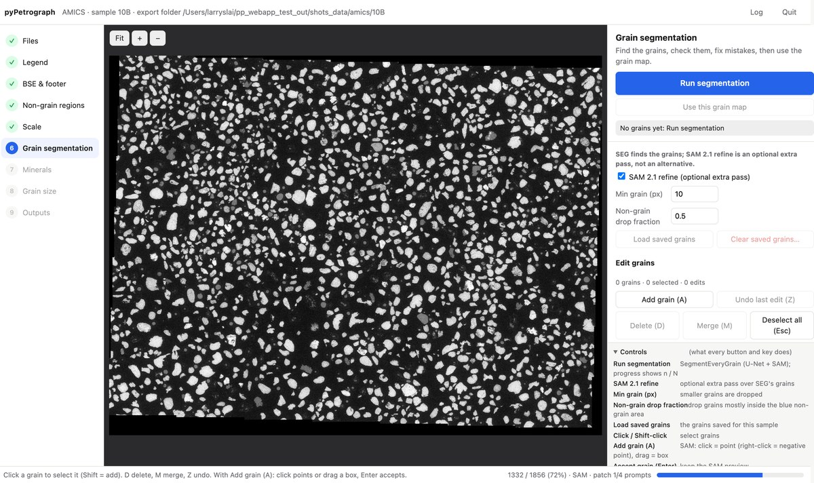
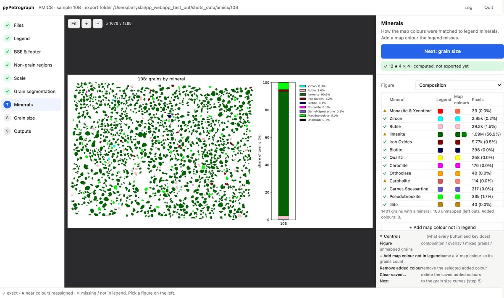
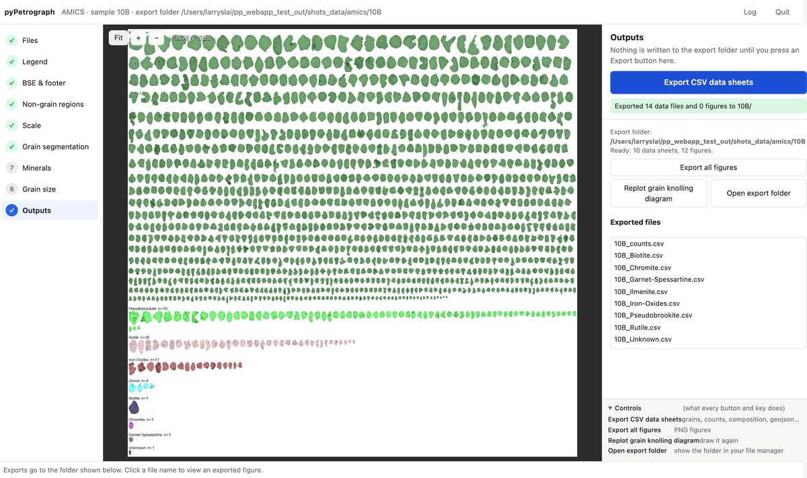
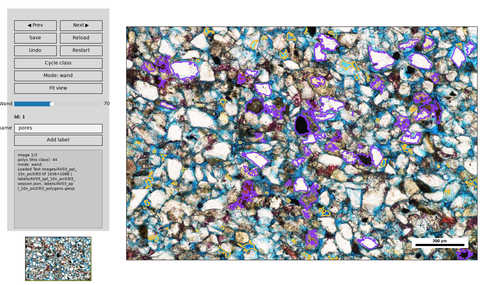
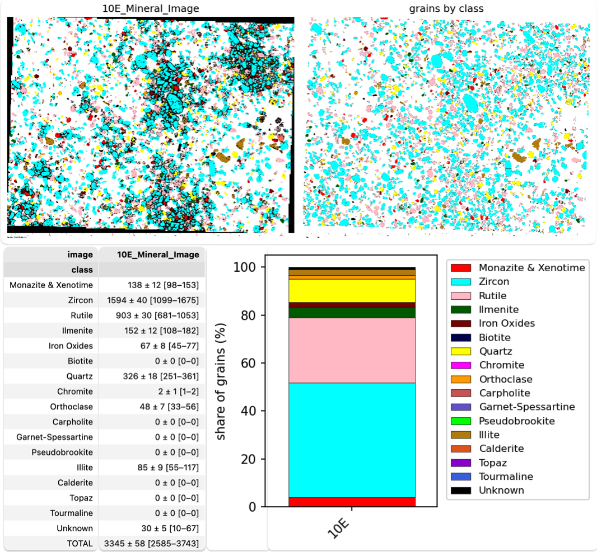
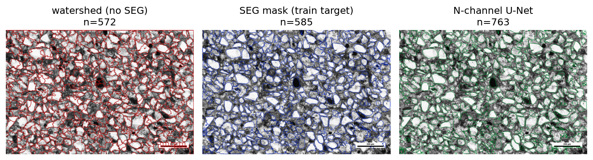
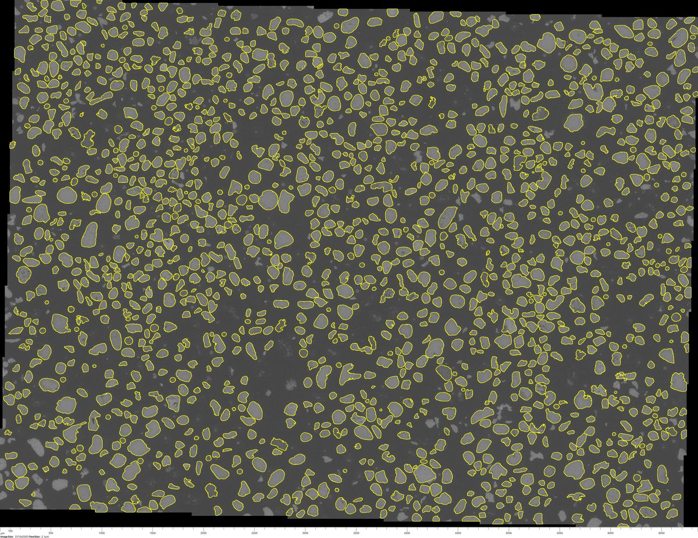
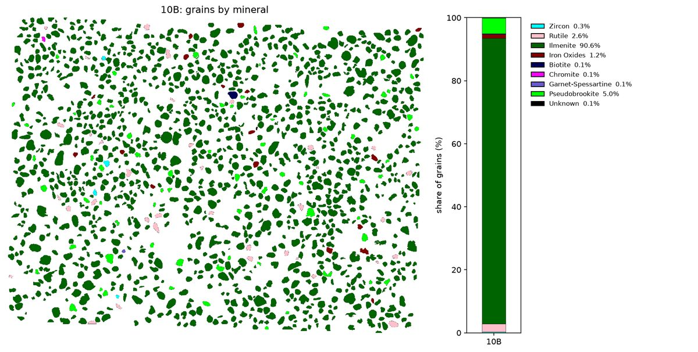
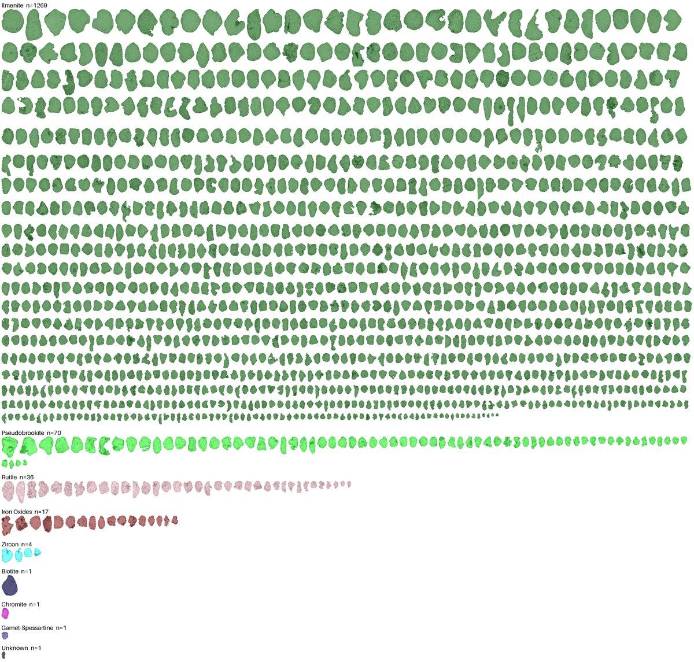

# pyPetrograph

 [](https://pepy.tech/project/pypetrograph) [](https://doi.org/10.5281/zenodo.23659316)

v0.2.0

pyPetrograph is a machine-learning toolkit for thin-section petrography. You can hand-label features on an RGB photo and train a LightGBM pixel model to map area % of each class (porosity in the demo). You can count grains on a painted mineral map by matching a color legend. You can stack several image types of the same field (PPL, XPL, or others) and segment grains from that overlay. Or, from an AMICS set (BSE, mineral map, and legend), you can outline grains on the BSE and name each grain from the map.

> [!WARNING]
> This tool is under development. Use with caution. Notebooks, APIs, and numbers can still change.

> [!NOTE]
> For more careful grain-boundary detection and mapping, there is optional support for using [SegmentEveryGrain](https://github.com/zsylvester/segmenteverygrain) developed by **Zoltan Sylvester**. [SAM 2.1](https://github.com/facebookresearch/sam2) weights (~860 MB) are a further opt-in on their page, not part of the default install.

pyPetrograph is developed by **Larry Syu-Heng Lai** (larrysyuhenglai@gmail.com). Part of the concept and base design (in Notebook 1) originated from early source code written by **Zoltan Sylvester** at the Quantitative Clastic Laboratory, Bureau of Economic Geology, The University of Texas at Austin. This project was initiated as part of a collaboration with **Priyanka Periwal**, **Lucy Tingwei Ko**, **Kelly Hattori**, and **Amanda Calle** across multiple research groups and the [e-MAGE lab](https://www.beg.utexas.edu/research/labs/sem), and Larry intends to continue it after his departure from the Bureau.

Example thin-section images are in `example_data/`. Analyzed results go to `outputs/`.

## Installation

Requires Python 3.10–3.12 (3.13+ installs, but legend OCR has no wheels there yet).

### Install from PyPI

```bash
pip install pyPetrograph
```

This installs the library, the notebooks' dependencies and the app (⚠️ **~930 MB** in total, see [Dependencies](#dependencies)). The notebook pop-up windows need one more package ([below](#dependencies)); grain segmentation needs SegmentEveryGrain ([below](#segmenteverygrain-optional-for-grain-segmentation)).

### Install from the repository

```bash
git clone https://github.com/GeoLarryLai/pyPetrograph.git
cd pyPetrograph
pip install .
```

Use `pip install -e .` instead for an editable (development) install.

Optional extras: `xgb`, `test`, `all`, e.g. `pip install "pyPetrograph[xgb]"`.

### SegmentEveryGrain (optional, for grain segmentation)

Grain segmentation (notebooks 3 and 4, and *Run segmentation* in the app) uses [SegmentEveryGrain](https://github.com/zsylvester/segmenteverygrain). Install it into the same environment as pyPetrograph (it brings TensorFlow, PyTorch and SAM 2.1):

```bash
pip install segmenteverygrain
```

pyPetrograph downloads the SegmentEveryGrain U-Net and, only if *SAM 2.1 refine* is on, the SAM 2.1 checkpoint (~860 MB) on first use. See the [SegmentEveryGrain repository](https://github.com/zsylvester/segmenteverygrain#installation) for full details and troubleshooting.

Without it, everything else works: notebooks 1 and 2, the non-segmentation steps of notebooks 3 and 4, and every app step, including *Load saved grains* and editing them. In the app, *Run segmentation* is greyed out with a link here.

## The app

`pypetrograph-app` runs the notebook 4 AMICS workflow step by step in your web browser (a local page, nothing is uploaded). You see and fix each result (legend names, non-grain regions, scale, grains, mineral matches) before moving on, and nothing is written to the export folder until you press an Export button. Its exports are byte-identical to notebook 4.

```bash
pypetrograph-app
# or
python -m pyPetrograph.webapp
```

**Files → Legend → BSE & footer → Non-grain regions → Scale (optional) → Grain segmentation → Minerals → Grain size → Outputs**

| | |
|---|---|
|  |  |
| **Legend:** OCR names you can edit, add, delete or recolour. | **Grain segmentation:** SegmentEveryGrain with live progress; click or box to add grains with SAM 2.1. |
|  |  |
| **Minerals:** one row per mineral, ✓ exact colour, ▲ reassigned, ✗ not found. | **Outputs:** knolling diagram and the CSV / figure export buttons. |

## Citation

Lai, L.S.-H. (2026) pyPetrograph. *Zenodo*, [https://doi.org/10.5281/zenodo.23659316](https://doi.org/10.5281/zenodo.23659316)

## Key Features

- Hand-label features and map their area %: paint a few examples of each class (pores, grains, cement, …); a LightGBM pixel classifier maps the photo and reports area % of each class. The demo treats pore area as porosity.
- Grain counts on a painted mineral map: match pixels to a color legend, split grains that touch, and count how many grains sit in each class.
- Segment grains from a multi-image overlay: line up PPL and XPL of the same field, stack them, and outline grains (watershed, optional SegmentEveryGrain, and the shipped N-channel U-Net).
- AMICS workflow: read a legend, outline grains on the BSE, name each grain from the mineral map, and write counts, a composition figure (grains by mineral and the percent of grains), grain sizes (a, b, D, ECD), size figures, and a knolling sheet (5500 px wide, largest ECD first).

## Example notebooks

### 1. Hand-label features and map their area %

[`pyPetrograph_1_rgb_porosity.ipynb`](pyPetrograph_1_rgb_porosity.ipynb)

You paint a few examples of each feature you care about (pores, grains, cement, …) using what you see — color, edge sharpness, and microtexture. A LightGBM pixel classifier (random forest or XGBoost optional) learns those examples, maps the rest of the photo, and reports area % of each class with a confidence range. The demo uses pores vs grains and treats pore area as porosity.



---

### 2. Grain counts on a painted mineral map

[`pyPetrograph_2_mineralmap_count.ipynb`](pyPetrograph_2_mineralmap_count.ipynb)

You already have a color mineral map (one flat color per mineral) and a legend. The notebook matches pixels to the legend, splits grains that touch, and counts how many grains sit in each class.



---

### 3. Segment grains from a multi-image overlay

[`pyPetrograph_3_multimodal_grains.ipynb`](pyPetrograph_3_multimodal_grains.ipynb)

A boundary drawn from PPL alone can miss contacts that only show under crossed polars (XPL), or the other way around. This notebook lines up PPL and XPL of the same field and stacks them as one overlay. Grain outlines go left to right in the same order as the work:

1. **Watershed** — first guess from brightness, no training.
2. **SEG mask** — optional [SegmentEveryGrain](https://github.com/zsylvester/segmenteverygrain) U-Net (Zoltan Sylvester). This saved mask is the **train target**.
3. **N-channel U-Net** (~25 MB, already in [`outputs/models/grain_unet_ppl-xpl.keras`](outputs/models/grain_unet_ppl-xpl.keras)) — trained on that PPL + XPL stack to copy the SEG mask. The notebook **loads** it and does not train again.

GrainPlot QC is a further optional window. [SAM 2.1](https://github.com/facebookresearch/sam2) (~860 MB, off by default) is only if you need still finer shapes.



---

### 4. AMICS: BSE grains named from a mineral map

[`pyPetrograph_4_AMICSworkflow.ipynb`](pyPetrograph_4_AMICSworkflow.ipynb)

Automated mineralogy (AMICS) gives a BSE image, a painted mineral map and a legend, but no per-grain sizes or counts. This notebook reads the legend (OCR, correctable), outlines every grain on the BSE with [SegmentEveryGrain](https://github.com/zsylvester/segmenteverygrain), names each grain by the map colour covering most of it, and measures its size. You get grain counts, composition and size distributions per mineral from one field. The same workflow is available in the [app](#the-app).

| Grain segmentation (10B) | Mineral composition (10B) | Knolling diagram (10B) |
|---|---|---|
|  |  |  |

Outputs (in `outputs/amics/{sample}/`): CSV data sheets (counts and per-mineral grain sizes a, b, D, ECD), GeoJSON grains, and figures (composition, overlay, size curves, knolling). Notebook steps and settings are in GUIDE.md.

## Package structure

```
README.md
README-PyPI.md
GUIDE.md
FUNCTION_DOCUMENTATION.md
example_data/
image/
pyPetrograph/
    align/
    common/
    fuse/
    image_processing/
    labeling_ml/
    mineral_map/
    objects/
    amics/
    app/
docs/images/
```

## Dependencies

Requires Python >=3.10.

Installed with the package (⚠️ **~930 MB** in total; measured on Linux, Python 3.12): numpy (>=1.24), pillow (>=10), matplotlib (>=3.7), scikit-learn (>=1.3), scipy (>=1.10), geopandas (>=0.14), shapely (>=2), rasterio (>=1.3), affine (>=2.4), joblib (>=1.3), pandas (>=2), lightgbm (>=4), scikit-image (>=0.22), rapidocr_onnxruntime (>=1.3; Python <3.13 only), fastapi (>=0.110) and uvicorn (>=0.27) for the app (~11 MB).

> [!NOTE]
> **rapidocr_onnxruntime** (legend OCR for notebook 4 and the app) is a large part of the default install: it adds **~220 MB** (onnxruntime ~80 MB, OpenCV ~120 MB, RapidOCR ~16 MB) on top of the other dependencies (~700 MB; measured on Linux, Python 3.12).

Notebook pop-up windows (notebook pickers, label/align/GrainPlot windows; not installed by default, the app does not need it): ⚠️ PySide6-Essentials (>=6.6, **~250 MB**), `pip install PySide6-Essentials`. Another Qt binding supported by Matplotlib also works if already installed. On Linux, the pop-up windows' Qt also needs a few system libraries (Debian/Ubuntu; use `libglib2.0-0` on older Ubuntu): `sudo apt-get install -y libegl1 libgl1 libxkbcommon0 libxkbcommon-x11-0 libfontconfig1 libfreetype6 libdbus-1-3 libglib2.0-0t64 libx11-6 libx11-xcb1 libxcb1 libxcb-cursor0 libxcb-icccm4 libxcb-image0 libxcb-keysyms1 libxcb-randr0 libxcb-render-util0 libxcb-shape0 libxcb-xfixes0 libxcb-xkb1`. The app needs none of them.

Optional extras (not installed by default):

- xgboost (`xgb`: xgboost >=2)
- tests (`test`: pytest >=7, httpx >=0.24)
- everything except tests: `all`

SegmentEveryGrain (TensorFlow, PyTorch, SAM 2) is not a pyPetrograph extra; install it with [its own instructions](https://github.com/zsylvester/segmenteverygrain).

## License

```text
Program: pyPetrograph
A toolkit for semi-automated, ML-assisted thin-section petrography:
porosity estimation, mineral counting, grain segmentation and micro-
texture analysis
Copyright (C) 2026  Larry Syu-Heng Lai
```

pyPetrograph is licensed under the GNU Affero General Public License 3.0 or later. See [LICENSE](LICENSE).
