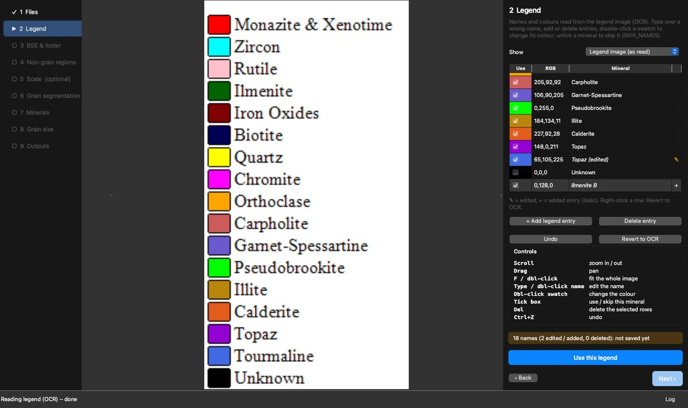
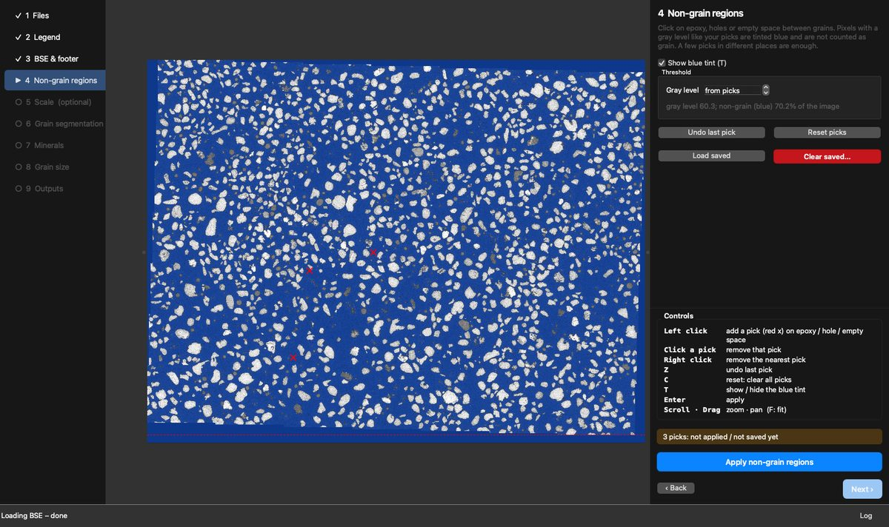
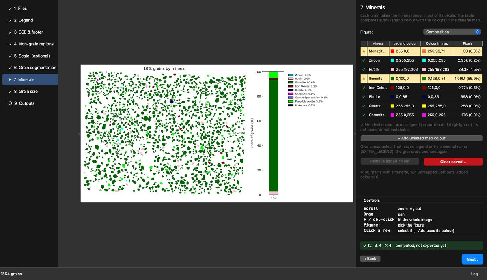
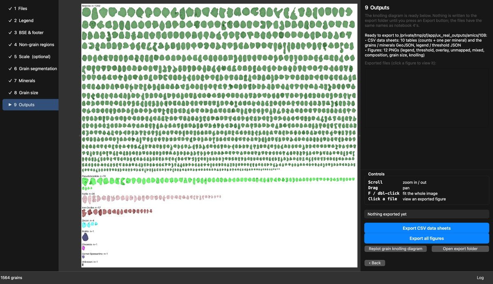

# pyPetrograph

  [](https://pepy.tech/project/pypetrograph)

v0.1.0

pyPetrograph is a machine-learning toolkit for thin-section petrography. You can hand-label features on an RGB photo and train a LightGBM pixel model to map area % of each class (porosity in the demo). You can count grains on a painted mineral map by matching a color legend. You can stack several image types of the same field (PPL, XPL, or others) and segment grains from that overlay. Or, from an AMICS set (BSE, mineral map, and legend), you can outline grains on the BSE and name each grain from the map.

> [!WARNING]
> This tool is under development. Use with caution. Notebooks, APIs, and numbers can still change.

> [!NOTE]
> For more careful grain-boundary detection and mapping, there is optional support for using [SegmentEveryGrain](https://github.com/zsylvester/segmenteverygrain) developed by **Zoltan Sylvester**. [SAM 2.1](https://github.com/facebookresearch/sam2) weights (~860 MB) are a further opt-in on their page, not part of the default install.

The current version is primarily developed by **Larry Syu-Heng Lai**, based on early source code scripted by **Zoltan Sylvester**, at the Quantitative Clastic Laboratory, Bureau of Economic Geology, The University of Texas at Austin. This development is also part of a collaboration with **Priyanka Periwal**, **Lucy Tingwei Ko**, **Kelly Hattori**, and **Amanda Calle** across multiple research groups and the [e-MAGE lab](https://www.beg.utexas.edu/research/labs/sem) in the Bureau of Economic Geology.

Example thin-section images are in `example_data/`. Analyzed results go to `outputs/`.

## Installation

pyPetrograph (and its desktop app) runs in whichever Python environment you launch it from, so it must be installed into that environment first. Any environment name works.

1. **Create and activate a Python environment** (name it anything; Python 3.10–3.12 recommended, since legend OCR has no 3.13+ wheels yet):

   ```bash
   conda create -n <your-env> python=3.11      # or: python -m venv <your-env>
   conda activate <your-env>                   # or: source <your-env>/bin/activate
   ```

   From this repo you can instead use `conda env create -f environment.yml -n <your-env>` (`-n` overrides the default name in the file).

2. **Install pyPetrograph into that activated environment:**

   ```bash
   pip install pyPetrograph            # notebooks / library only
   pip install "pyPetrograph[app]"     # plus the desktop app (PySide6 + legend OCR)
   pip install -e ".[app]"             # or: from a checkout of this repo
   ```

   Optional: finer grain-boundary mapping with [SegmentEveryGrain](https://github.com/zsylvester/segmenteverygrain) — `pip install segmenteverygrain` into the same activated env (its “existing environment” path). SAM 2.1 weights (~860 MB) are a further opt-in on their page, not part of this pip install.

3. **Launch the app from that same activated environment** with `pypetrograph-app` (see [The desktop app](#the-desktop-app)). If an app package is missing, it prints the `pip install` command to run and exits.

## The desktop app

`pypetrograph-app` runs the notebook 4 AMICS workflow interactively in one window: steps on the left, the image in the centre, settings on the right. You see and fix each result (legend names, non-grain regions, scale, grains, mineral matches) before moving on. Nothing is written to the export folder until you press an Export button.

```bash
conda activate <your-env>           # any Python 3.10-3.12 env (or: source <your-env>/bin/activate)
pip install "pyPetrograph[app]"     # install the app into it
pypetrograph-app                    # or: python -m pyPetrograph.app
```

**Files → Legend → BSE & footer → Non-grain regions → Scale (optional) → Grain segmentation → Minerals → Grain size → Outputs**

| | |
|---|---|
|  |  |
| **Legend:** OCR names you can edit, add, delete or recolour (✎ edited, + added). | **Non-grain regions:** click epoxy / holes; the blue tint shows what is left out. |
|  |  |
| **Minerals:** one row per mineral, ✓ exact colour, ▲ reassigned, ✗ not found. | **Outputs:** knolling diagram and the CSV / figure export buttons. |

Segmentation needs the `seg` extra (and `sam2` for SAM refine). Model weights are looked up in `<output>/models`, `outputs/models`, `models/` and `~/.cache/pyPetrograph/models` (or `$PYPETROGRAPH_MODELS`) and downloaded to the cache only if missing. Headless tests: `pip install -e ".[app,test]"`, then `QT_QPA_PLATFORM=offscreen pytest pyPetrograph/app`.

**Linux system libraries** (Debian/Ubuntu; PySide6 needs these from the system). On older Ubuntu use `libglib2.0-0` instead of `libglib2.0-0t64`.

```bash
# offscreen / tests
sudo apt-get install -y libegl1 libgl1 libxkbcommon0 libfontconfig1 libfreetype6 libdbus-1-3 libglib2.0-0t64 libx11-6 libxcb1
# on-screen window (X11), in addition
sudo apt-get install -y libxkbcommon-x11-0 libx11-xcb1 libxcb-cursor0 libxcb-icccm4 libxcb-image0 libxcb-keysyms1 libxcb-randr0 libxcb-render-util0 libxcb-shape0 libxcb-xfixes0 libxcb-xkb1
```

## Citation

Lai, L.S.-H. (2026) pyPetrograph.

Contact: larrysyuhenglai@gmail.com

## Key Features

- Hand-label features and map their area %: paint a few examples of each class (pores, grains, cement, …); a LightGBM pixel classifier maps the photo and reports area % of each class. The demo treats pore area as porosity.
- Grain counts on a painted mineral map: match pixels to a color legend, split grains that touch, and count how many grains sit in each class.
- Segment grains from a multi-image overlay: line up PPL and XPL of the same field, stack them, and outline grains (watershed, optional SegmentEveryGrain, and the shipped N-channel U-Net).
- AMICS workflow: read a legend, outline grains on the BSE, name each grain from the mineral map, and write counts, a composition figure (grains by mineral and the percent of grains), grain sizes (a, b, D, ECD), size figures, and a knolling sheet (5500 px wide, largest ECD first).

## Example notebooks

### 1. Hand-label features and map their area %

[`pyPetrograph_1_rgb_porosity.ipynb`](pyPetrograph_1_rgb_porosity.ipynb)

You paint a few examples of each feature you care about (pores, grains, cement, …) using what you see — color, edge sharpness, and microtexture. A LightGBM pixel classifier (random forest or XGBoost optional) learns those examples, maps the rest of the photo, and reports area % of each class with a confidence range. The demo uses pores vs grains and treats pore area as porosity.


---

### 2. Grain counts on a painted mineral map

[`pyPetrograph_2_mineralmap_count.ipynb`](pyPetrograph_2_mineralmap_count.ipynb)

You already have a color mineral map (one flat color per mineral) and a legend. The notebook matches pixels to the legend, splits grains that touch, and counts how many grains sit in each class.


---

### 3. Segment grains from a multi-image overlay

[`pyPetrograph_3_multimodal_grains.ipynb`](pyPetrograph_3_multimodal_grains.ipynb)

A boundary drawn from PPL alone can miss contacts that only show under crossed polars (XPL), or the other way around. This notebook lines up PPL and XPL of the same field and stacks them as one overlay. Grain outlines go left to right in the same order as the work:

1. **Watershed** — first guess from brightness, no training.
2. **SEG mask** — optional [SegmentEveryGrain](https://github.com/zsylvester/segmenteverygrain) U-Net (Zoltan Sylvester). This saved mask is the **train target**.
3. **N-channel U-Net** (~25 MB, already in [`outputs/models/grain_unet_ppl-xpl.keras`](outputs/models/grain_unet_ppl-xpl.keras)) — trained on that PPL + XPL stack to copy the SEG mask. The notebook **loads** it and does not train again.

GrainPlot QC is a further optional window. [SAM 2.1](https://github.com/facebookresearch/sam2) (~860 MB, off by default) is only if you need still finer shapes.


---

### 4. AMICS: BSE grains named from a mineral map

[`pyPetrograph_4_AMICSworkflow.ipynb`](pyPetrograph_4_AMICSworkflow.ipynb)

Automated mineralogy (AMICS) gives a BSE image, a painted mineral map and a legend, but no per-grain sizes or counts. This notebook reads the legend (OCR, correctable), outlines every grain on the BSE with [SegmentEveryGrain](https://github.com/zsylvester/segmenteverygrain), names each grain by the map colour covering most of it, and measures its size. You get grain counts, composition and size distributions per mineral from one field. The same workflow is available in the [desktop app](#the-desktop-app).

| Grain segmentation (10B) | Mineral composition (10B) | Knolling diagram (10B) |
|---|---|---|
|  |  |  |

Outputs (in `outputs/amics/{sample}/`): CSV data sheets (counts and per-mineral grain sizes a, b, D, ECD), GeoJSON grains, and figures (composition, overlay, size curves, knolling). Notebook steps and settings are in GUIDE.md.

## Package structure

```
README.md
README-PyPI.md
GUIDE.md
FUNCTION_DOCUMENTATION.md
example_data/
image/
pyPetrograph/
    align/
    common/
    fuse/
    image_processing/
    labeling_ml/
    mineral_map/
    objects/
    amics/
    app/
docs/images/
```

## Dependencies

Requires Python >=3.10.

Installed with the package: numpy (>=1.24), pillow (>=10), matplotlib (>=3.7), scikit-learn (>=1.3), scipy (>=1.10), geopandas (>=0.14), shapely (>=2), rasterio (>=1.3), affine (>=2.4), joblib (>=1.3), pandas (>=2), lightgbm (>=4), scikit-image (>=0.22), PyQt5 (>=5.15).

Optional extras (not installed by default):

- segmenteverygrain / tensorflow (`seg`: tensorflow >=2.16,<2.22, keras >=3, segmenteverygrain ==0.5.0)
- sam2 / torch (`sam2`: torch >=2.2, torchvision, sam2 >=1.0)
- xgboost (`xgb`: xgboost >=2)
- legend text (`amics`: rapidocr_onnxruntime >=1.3, which brings onnxruntime; Python 3.10–3.12 only, so on 3.13+ the legend names fall back to swatch_1..N)
- desktop app (`app`: PySide6 >=6.6, rapidocr_onnxruntime >=1.3) — run with `pypetrograph-app`
- tests (`test`: pytest >=7, pytest-qt >=4.2)
- everything except tests: `all`

## License

```text
Program: pyPetrograph
A toolkit for semi-automated, ML-assisted thin-section petrography:
porosity estimation, mineral counting, grain segmentation and micro-
texture analysis
Copyright (C) 2026  Larry Syu-Heng Lai
```

pyPetrograph is licensed under the GNU Affero General Public License 3.0 or later. See [LICENSE](LICENSE).
